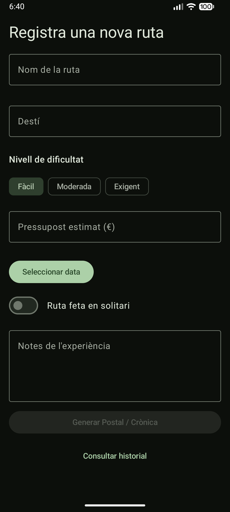
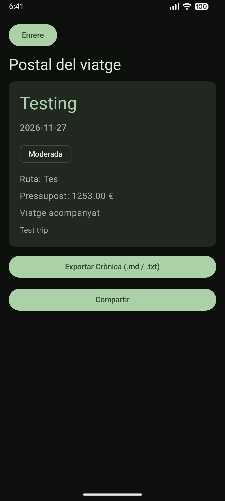

# Diari de Viatges / Crònica de Ruta

Aplicació Android feta amb **Kotlin** i **Jetpack Compose** que permet registrar rutes o escapades, generar una postal/crònica visual, consultar l'historial i exportar el relat.

Implementa les **fases 1 i 2** de l'enunciat (`Assignment.md`).

## Funcionalitats

- Formulari de nova ruta amb validació visual en temps real.
- Selector de dificultat amb `FilterChip`, data amb `DatePickerDialog` i interruptor de viatge en solitari.
- Generació de la postal amb el destí destacat, insignia de dificultat, pressupost i relat.
- Historial persistent de rutes desades a l'emmagatzematge intern (`filesDir`).
- Exportació de la crònica a un fitxer `.md` mitjançant l'Storage Access Framework i opció de compartir.

## Arquitectura MVVM

El projecte separa el model immutable de la lògica de presentació. El flux de dades és unidireccional: la interfície demana dades al ViewModel, i les dades tornen a pujar cap a la interfície.

```
FormScreen / PostalScreen / HistoryScreen   (ui/)
              │  collectAsStateWithLifecycle
              ▼
TravelDiaryViewModel  (ui/)  ──  MutableStateFlow privat → StateFlow públic (.asStateFlow())
              │  .copy() per actualitzar l'estat de manera immutable
              ▼
GetRoutesUseCase / SaveRouteUseCase / FormatChronicleUseCase   (domain/usecase/)
              ▼
DiaryRepository (interfície, domain/repository/)
              ▼
DiaryRepositoryImpl (data/repository/)  ──  converteix DTO ↔ model de domini
              ▼
DiaryFileDataSource (data/local/)
              ▼
context.filesDir/diari_viatges.json
```

### Capes

| Capa | Ubicació | Responsabilitat |
| --- | --- | --- |
| Model | `domain/model/` | `RouteEntry`, `Difficulty` i `TravelDiaryUiState`. Dades immutables, sense dependències d'Android. |
| Repositori (contracte) | `domain/repository/` | `DiaryRepository`: què pot fer l'aplicació amb les rutes, sense saber on es desen. |
| Casos d'ús | `domain/usecase/` | `GetRoutesUseCase`, `SaveRouteUseCase` i `FormatChronicleUseCase`: una acció cadascun. |
| Dades | `data/model/`, `data/local/`, `data/repository/` | `RouteEntryDto` (`@Serializable`), lectura/escriptura del JSON i traducció DTO ↔ domini. |
| Presentació | `ui/` | Pantalles, ViewModel, estat de la interfície i navegació. |
| Injecció de dependències | `di/` | `AppContainer` crea els objectes i `LocalTravelDiaryViewModel` els fa accessibles a les pantalles. |

`RouteEntryDto` conserva la dificultat com a `String` (format del fitxer), mentre que `RouteEntry` la converteix a l'enum `Difficulty`. Aquesta conversió es fa amb extensions privades (`toDomain()` i `toDto()`) dins de `DiaryRepositoryImpl`, de manera que el format d'emmagatzematge no es filtra cap a la interfície ni cap al domini.

### Estat i navegació

`TravelDiaryViewModel` manté un `MutableStateFlow<TravelDiaryUiState>` privat i exposa un `StateFlow` públic amb `.asStateFlow()`. Cada canvi del formulari es fa amb `.copy()`, i les pantalles observen l'estat amb `collectAsStateWithLifecycle`. La validació calcula `routeNameError`, `destinationError` i `budgetError`; `isFormValid` determina si el botó «Generar Postal / Crònica» està actiu.

La navegació (`ui/navigation/AppNavigation.kt`) té tres destinacions: `form` (creació de la ruta), `history` (llistat) i `postal/{routeId}` (detall de la ruta). Només es passa l'identificador de la ruta; la ruta completa es llegeix de l'estat compartit del ViewModel, que s'ha creat una sola vegada a `MainActivity` i s'ha proporcionat amb `CompositionLocalProvider`.

## Captures de pantalla


| Formulari de nova ruta                          | Postal / crònica                             |
|-------------------------------------------------|----------------------------------------------|
|  |  |

Les ordres es poden executar al terminal de l'IDE, a PowerShell o a CMD, sempre que `adb` sigui al `PATH` i hi hagi un emulador o dispositiu connectat amb l'app oberta. La carpeta `docs/` ja existeix.

Amb PowerShell 5.1 no convé fer servir `>` perquè converteix la sortida binària en text i es trenca el PNG. Fes servir `adb pull`:

```powershell
$adb = "$env:LOCALAPPDATA\Android\Sdk\platform-tools\adb.exe"
& $adb shell screencap -p /sdcard/form-screen.png
& $adb pull /sdcard/form-screen.png docs\form-screen.png
```

Si `adb` ja és al `PATH`, podeu substituir `& $adb` per `adb`. Comproveu la connexió amb `& $adb devices`.

Després genera una postal i repeteix amb `postal-screen.png`. També podeu fer servir el botó de captura de pantalla del panell «Running Devices» d'Android Studio i desar les imatges directament a `docs/`.

## Emmagatzematge intern vs. extern

| | Intern (`filesDir`) | Extern (Storage Access Framework) |
| --- | --- | --- |
| On està | Directori privat de l'app: `context.filesDir/diari_viatges.json`. | Carpeta que tria l'usuari (Documents, Descàrregues…). |
| Format | JSON amb tot l'historial de rutes. | Fitxer de text `.md` amb una sola crònica formatada. |
| Permisos | Cap; l'app és propietària del fitxer. | Cap permís d'escriptura: el sistema obre el selector i concedeix l'accés temporalment. |
| Visibilitat | Només l'app hi pot accedir. | L'usuari pot veure, moure, copiar i esborrar el fitxer. |
| Interacció | Automàtic: es desa en generar la crònica i es llegeix en obrir l'app. | Manual: l'usuari prem «Exportar Crònica» i tria la ubicació. |
| Actualitzacions de l'app | Les dades es conserven. | Les dades es conserven. |
| **Si es desinstal·la l'app** | **El fitxer s'esborra juntament amb l'app; es perd l'historial.** | **El fitxer exportat roman al dispositiu**, perquè pertany a l'usuari i no a l'app. |

En resum: l'emmagatzematge intern és una memòria privada i còmoda per a l'estat de l'aplicació, però volàtil davant la desinstal·lació. L'extern és una còpia explícita i portàtil, pensada per conservar i compartir el relat fora de l'app.

## Conceptes apresos

- **MVVM amb `StateFlow`**: estat privat mutable, estat públic immutable i actualitzacions amb `.copy()` (`ui/TravelDiaryViewModel.kt`).
- **`collectAsStateWithLifecycle`**: converteix el `StateFlow` en estat de Compose respectant el cicle de vida (`ui/form/`, `ui/postal/`, `ui/history/`).
- **`OutlinedTextField` amb `isError` i `supportingText`**: missatges d'error en temps real (`ui/form/FormScreen.kt`).
- **`KeyboardOptions` / `KeyboardType.Decimal`**: teclat numèric per al pressupost (`ui/form/FormScreen.kt`).
- **`FilterChip`**: selector únic de dificultat (`ui/form/FormScreen.kt`).
- **`DatePickerDialog` i `rememberDatePickerState`**: selecció de data amb el diàleg de Material 3 (`ui/form/FormScreen.kt`).
- **`Switch`**: opció «Ruta feta en solitari» (`ui/form/FormScreen.kt`).
- **`LazyColumn`**: llistat eficient de l'historial (`ui/history/HistoryScreen.kt`).
- **Navigation Compose**: `NavHost`, `composable` i `navArgument` per passar l'id de la ruta (`ui/navigation/AppNavigation.kt`).
- **`CompositionLocal`**: compartir el ViewModel entre pantalles sense passar-lo paràmetre a paràmetre (`di/LocalTravelDiaryViewModel.kt`).
- **Serialització JSON**: `@Serializable`, `Json` i `encodeToString`/`decodeFromString` amb kotlinx.serialization (`data/`).
- **`filesDir`**: escriptura i lectura persistents de l'historial (`data/local/DiaryFileDataSource.kt`).
- **`ActivityResultContracts.CreateDocument("text/plain")`**: selector del sistema per exportar la crònica (`ui/postal/PostalScreen.kt`).
- **`Intent.ACTION_SEND` + `createChooser`**: compartir el text amb altres apps (`ui/postal/PostalScreen.kt`).
- **Coroutines i `Dispatchers.IO`**: operacions de fitxer fora del fil principal (`data/repository/DiaryRepositoryImpl.kt`).

## Limitació coneguda

`estimatedBudget` és un `Double`, tal com demana l'enunciat. Els valors sencers només són exactes fins a 2^53 (≈ 9 × 10¹⁵); a partir d'uns 17 dígits, els últims dígits es representen com a zeros per la precisió del format IEEE 754. No és un problema de lectura o escriptura del JSON: la pèrdua ja es produeix en convertir el text introduït a `Double`.

## Compilació

```bash
./gradlew assembleDebug
```

A Windows: `gradlew.bat assembleDebug`. Requereix Android Studio / SDK d'Android amb API 37.
